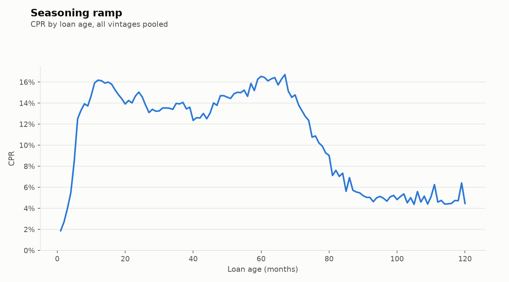

# RMBS Prepayment & Default Analytics

[](https://github.com/stellt/dataanalystportfolio/actions/workflows/prepayment-model.yml)

A small, tested Python library that turns Freddie Mac loan-level mortgage data into
prepayment and default analytics (CPR, CDR, loss severity) and fits a logistic
prepayment model with an out-of-time test. One command runs the whole pipeline:

```bash
rmbs all
```

| Output | Where |
| --- | --- |
| Clean loan-month panel with event flags | `data/processed/panel/` |
| CPR / CDR by vintage, FICO, LTV, incentive and loan age | `data/processed/cohorts/`, `reports/tables/` |
| Charts (vintage curves, S-curve, seasoning ramp, model fit) | `reports/figures/` |
| Logistic model: coefficients, AUC, actual vs predicted CPR | `reports/tables/model_*` |
| Findings write-up | [`reports/results.md`](reports/results.md) |

## Results

> Charts below are generated by `rmbs all` and committed from `reports/figures/`.

| | |
| --- | --- |
|  |  |
|  |  |

See [`reports/results.md`](reports/results.md) for the findings.

## Setup

Python 3.11 or later.

```bash
cd prepayment-model
python -m venv .venv && source .venv/bin/activate
pip install -e ".[dev]"
pytest            # 43 tests, a few seconds
```

## Get the data

Raw files are never committed (`data/` is git-ignored).

1. **Freddie Mac Single-Family Loan-Level Dataset.** Register (free) via the
   [SFLLD page](https://www.freddiemac.com/research/datasets/sf-loanlevel-dataset);
   downloads are served through Freddie Mac's Clarity Data Intelligence portal.
   Download the **sample** files (about 50,000 loans per origination year) for
   **2015 to 2022**, unzip them and put the `.txt` files in `data/raw/`:

   ```
   data/raw/sample_orig_2015.txt   data/raw/sample_svcg_2015.txt
   ...
   data/raw/sample_orig_2022.txt   data/raw/sample_svcg_2022.txt
   ```

   Full quarterly files (`orig_YYYYQn.txt` / `perf_YYYYQn.txt`, or the older
   `historical_data_YYYYQn.txt` / `historical_data_time_YYYYQn.txt`) also work.
   If your download uses other names, add a pattern under `raw_files` in
   `config/analysis.yaml`.

2. **PMMS 30-year mortgage rate** (FRED series `MORTGAGE30US`). `rmbs all`
   downloads it automatically; to fetch it on its own, run `rmbs fetch-pmms`.

## Run

```bash
rmbs ingest      # raw text -> typed parquet (data/interim/)
rmbs panel       # loan-month panel, event flags, start_upb, incentive, months_itm
rmbs metrics     # cohort tables + charts
rmbs model       # fit, evaluate out of time, save coefficients and charts
rmbs all         # every step in order
```

Every command takes `--config path/to/analysis.yaml`. Analysis choices (vintages,
bucket edges, the split date, suppression threshold, the model formula) live in
`config/analysis.yaml`; file layouts and code meanings live in `config/schema.yaml`.

## Method

### Data and file layouts

Freddie Mac files are pipe-delimited with no header, so columns are identified by
position. `config/schema.yaml` holds two layouts and the loader picks one by counting
fields in the first row:

* **Release 47** (files published from July 2026): 31 origination fields and 35
  performance fields. Servicer name and the MI-cancellation flag moved into the monthly
  file; VantageScore 4.0 and bankruptcy cramdown costs were added.
* **Legacy** (earlier downloads): 32 and 32 fields.

Raw text is converted to Parquet once (`data/interim/`); every later step reads
Parquet. Not-available sentinels (FICO `9999`, LTV/CLTV/DTI `999`, and so on) load as
null.

### The loan-month panel

One row per loan per month, with origination attributes joined on. Every metric is
computed from this table.

| Field | Definition |
| --- | --- |
| `active_start` | Outstanding at the start of the month; the only rows in a denominator |
| `start_upb` | Last month's actual UPB (first month: original UPB) |
| `prepaid` | Leaves with zero balance code `01` (voluntary payoff), excluding payoffs at scheduled maturity |
| `defaulted` | First month 180+ days delinquent (or REO), or a credit exit: codes `02` third-party sale, `03` short sale / charge-off, `09` REO disposition, `15` whole-loan (note) sale. At most once per loan |
| `incentive_bp` | (note rate − PMMS 30y rate) × 100, using last month's PMMS (positive = in the money) |
| `months_itm` | Number of earlier months the loan was more than 50 bp in the money (burnout proxy) |

### Rates

All rates are balance-weighted by `start_upb`, as the market quotes them:

```
SMM = Σ start_upb · prepaid   / Σ start_upb · active_start      CPR = 1 − (1 − SMM)^12
MDR = Σ start_upb · defaulted / Σ start_upb · active_start      CDR = 1 − (1 − MDR)^12
Severity = −Σ actual loss / Σ UPB at liquidation   (liquidated loans only, by default year)
```

Cohort tables cut by vintage, FICO (<680, 680–719, 720–759, 760+), LTV (≤60, 60–80,
80–90, 90+) and incentive (25 bp buckets from ≤ −100 to > +150), each by calendar
month and by loan age (1–120). Every table reports the loan count and UPB behind each
rate, and cells with fewer than 200 active loans are suppressed.

### Prepayment model

A discrete-time hazard model: a logistic regression for the probability that an
active loan prepays this month, fitted with `statsmodels` so coefficients come with
standard errors.

| Feature | Captures | Form |
| --- | --- | --- |
| Refinancing incentive | The S-curve | Natural cubic spline, 4 df (clipped to ±300 bp) |
| Loan age | Seasoning ramp | Linear, capped at 30 months |
| `months_itm` | Burnout | log(1 + months) |
| FICO, LTV | Ability to refinance | Buckets |
| Original UPB | Dollar benefit of refinancing | log |
| Loan purpose, occupancy | Cash-out and investor behaviour | Categorical |
| Calendar month | Seasonality in home sales | Categorical |

* **Out-of-time split:** train on reporting months up to Dec 2020, test on Jan 2021
  onward. A random split would leak future rate conditions into training.
* **Downsampling:** training keeps every prepayment and 20% of non-prepayments, which
  multiplies the odds by 5. Predictions add log(0.2) back to the intercept; a test
  checks that corrected predictions sum to the actual number of prepayments.
* **Evaluation:** actual vs predicted CPR by month and by incentive bucket, plus AUC
  and log-loss. `model_stats.json` also records whether the fit converged, the burnout
  coefficient's sign and whether the fitted S-curve rises with incentive.

## Limitations

* **Curtailments are ignored.** Only full payoffs count as prepayments, so speeds are
  slightly understated, mostly for seasoned loans where partial prepayments are common.
* **Default is a 180-day delinquency trigger**, not a liquidation, so CDR leads
  realised losses by months or years. A loan that defaults and later pays off in full
  still counts as a voluntary payoff when it leaves.
* **Sample files** hold about 50,000 loans per vintage; thin cells (high LTV, low FICO,
  late loan ages) are suppressed rather than shown as noisy speeds.
* **The model is pool-agnostic.** It has no rate-path simulation, no turnover/housing
  model and no servicer or geographic effects. It explains speeds given realised
  rates; it does not forecast rates.
* **Loan age resets on modification** in Freddie Mac's data, which slightly distorts the
  seasoning ramp for modified loans.

## Project structure

```
prepayment-model/
├── config/
│   ├── schema.yaml           # column layouts (legacy + Release 47), dtypes, code meanings
│   └── analysis.yaml         # vintages, buckets, split date, thresholds, model formula
├── src/rmbs_analytics/
│   ├── config.py             # load + validate yaml
│   ├── ingest.py             # raw text -> typed parquet (streamed)
│   ├── panel.py              # join, loan-month panel, event flags, start_upb
│   ├── rates.py              # PMMS monthly average, incentive, months_itm
│   ├── metrics.py            # smm, cpr, mdr, cdr, severity, cohort tables
│   ├── model.py              # features, split, fit, predict, evaluation
│   ├── plots.py              # all charts
│   └── cli.py                # `rmbs` command
├── tests/
│   ├── fixtures/             # hand-built raw files (both layouts) + PMMS sample
│   └── test_*.py             # 43 tests; every expected number checkable on paper
└── reports/
    ├── figures/              # generated charts (committed)
    ├── tables/               # summary tables (committed)
    └── results.md            # findings write-up
```

## Tests

`pytest` runs on every push via GitHub Actions (Python 3.11 and 3.12), along with
`ruff check`. Key cases:

| Test | Checks |
| --- | --- |
| `test_smm_to_cpr` | SMM 1% → CPR 11.36%; SMM 0 → CPR 0 |
| `test_cohort_cpr_hand_case` | 4 × $100k loans, one prepays in month 3 → SMM 25%, CPR 96.8% |
| `test_prepaid_flag` | Code `01` flags a prepayment; a payoff at maturity does not |
| `test_default_once` | 180+ days delinquent for several months → one default, in the first month |
| `test_active_denominator` | Loans gone in an earlier month (even with a later defect record) are excluded |
| `test_start_upb` | Uses last month's balance; the first month uses original UPB |
| `test_incentive` | 6.5% note rate vs 5.0% PMMS → +150 bp |
| `test_schema` | Ingested columns and dtypes match `schema.yaml`, for both layouts |
| `test_model_smoke` | Model fits on a seeded synthetic panel; predictions lie in [0, 1] |
| `test_pipeline_end_to_end` | Raw fixture files → panel → tables and charts |
