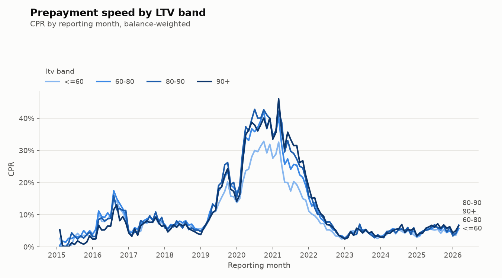

# Results: Freddie Mac 2015–2022 prepayment and default

> **Status: template.** Fill in each `[ ]` from `reports/tables/` and
> `reports/figures/` after running `rmbs all` on the 2015–2022 sample files. Keep the
> whole write-up to one page.

**Data:** Freddie Mac SFLLD sample, vintages 2015–2022, [ ] loans and [ ] loan-months,
reporting months [ ] to [ ]. PMMS 30-year rate from FRED (`MORTGAGE30US`).

## 1. Prepayment speeds

* **Refinancing wave.** Pooled CPR peaked at [ ]% in [month], against [ ]% in 2019.
  *Look at:* `overall_by_period` in `data/processed/cohorts/`.
* **Vintage effect.** 2018–2019 vintages (originated at higher rates) prepaid
  [faster/slower] than 2020–2021 vintages, which were [ ] bp out of the money after
  2022. *Look at:* `vintage_by_period`.
* **2022 rate rise.** CPR fell to [ ]% by [month] as incentives turned negative.

## 2. The S-curve and burnout

* CPR rises from [ ]% for loans ≤ −100 bp out of the money to [ ]% above +150 bp.
  The steepest part of the curve is between [ ] and [ ] bp.
* Burnout: loans that had been in the money for 12+ months prepaid at [ ]% vs [ ]% for
  newly in-the-money loans at the same incentive (model coefficient on
  `log_months_itm`: [ ], expected negative).

## 3. Credit cuts

 

* 760+ FICO borrowers prepaid [ ]× faster than <680 borrowers during the wave
  (ability to refinance).
* High-LTV (90+) loans: CPR [ ]%, CDR [ ]%.
* Defaults: CDR [ ]% overall; the [ ] cohort peaked at [ ]% in [ ] (COVID forbearance
  shows up as 180+ day delinquency in 2020–21: [ ] in the write-up).
* Severity (liquidated loans only): [ ]% on [ ] resolved loans
  (`severity_by_default_year.csv`).

## 4. Model: out-of-time test (train ≤ Dec 2020, test ≥ Jan 2021)

| Statistic | Value |
| --- | --- |
| Train / test loan-months | [ ] / [ ] |
| AUC (test) | [ ] |
| Log-loss (test) | [ ] |
| Converged | [ ] |
| Incentive effect | S-curve rises with incentive: [yes/no] |
| Burnout coefficient | [ ] (expected < 0) |

**Where the model misses, and why.** [Two or three sentences. Questions to answer:
Does it under-predict the 2021 peak (lender capacity and cash-out refinancing were
unusual)? Does it over-predict after 2022, when nearly every loan was out of the money
and turnover (home sales) dominated, a driver the model has no feature for? Is the
miss concentrated in particular incentive buckets? See `model_by_incentive.png`.]

## 5. What I would change with more time

[One design choice, e.g. add a turnover/housing-sales term, model curtailments
separately, or fit the default model with the same set-up.]
