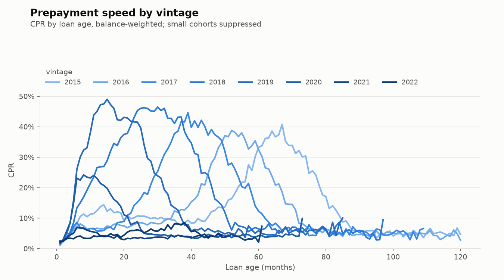
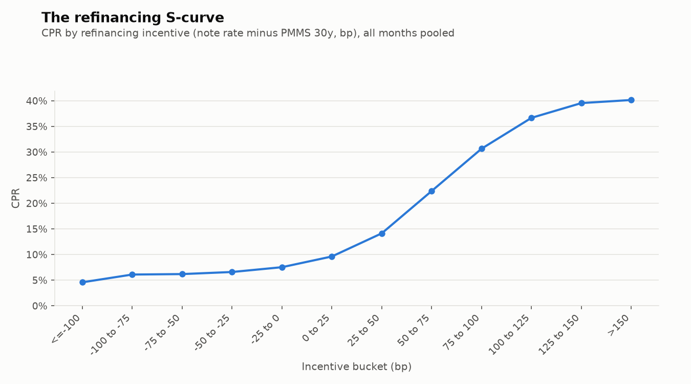
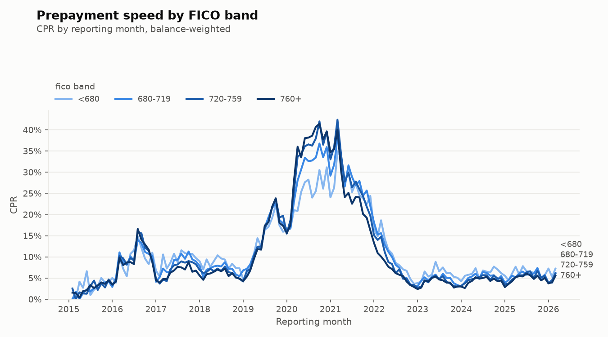
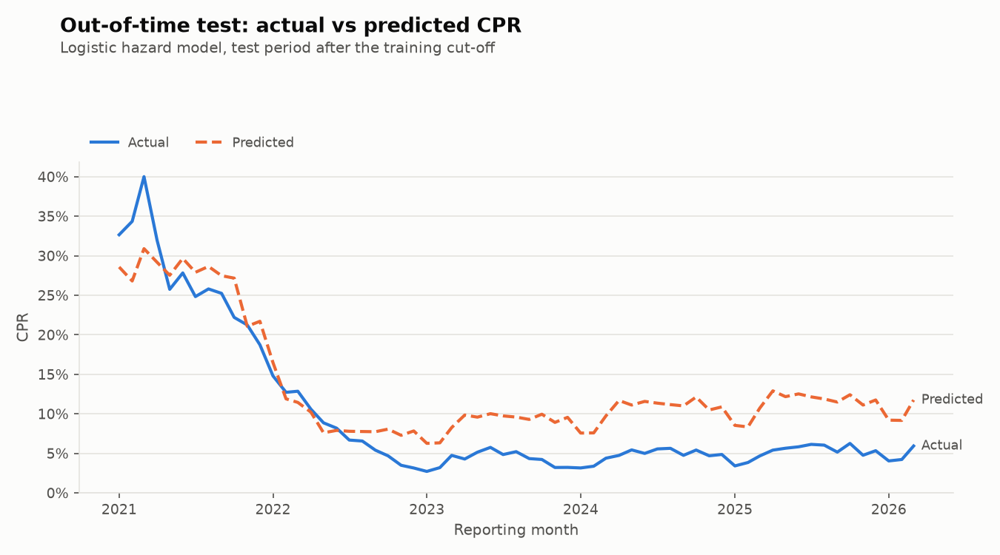

# Results: Freddie Mac 2015–2022 prepayment and default

**Data:** Freddie Mac SFLLD sample files (Release 47 layout), origination years
2015–2022: 400,000 loans and 20.7 million loan-months, reporting months Jan 2015 to
Mar 2026. Market rate: Freddie Mac PMMS 30-year (FRED `MORTGAGE30US`), monthly
average, lagged one month. All rates are balance-weighted; CPR and CDR are annualised.

## 1. Prepayment speeds follow rates

* **The refinancing wave.** Pooled CPR averaged 14.5% in 2019, then 35.0% from
  Jul 2020 to Jun 2021, and peaked at **40.1% in Oct 2020**.
* **The 2022 rate rise.** CPR fell to **2.7% by Jan 2023** and averaged 4.2% in 2023
  and 5.0% in 2024–25, which is turnover only.
* **Vintage is a rate story.** 2018 and 2019 loans, written at higher rates, peaked at
  45–49% CPR and prepaid at 23–24% over their lives. 2021 and 2022 loans (4.1% and
  4.9% lifetime CPR) have barely prepaid at all; they were out of the money almost
  from the start.
* **Seasoning ramp.** New loans are slow: CPR is 1.9% in month 1, 4.0% in month 3,
  12.5% in month 6 and 16.2% by month 12 (pooled over all rate regimes).

## 2. The S-curve and burnout

* CPR rises from **4.6%** for loans 100 bp or more out of the money to **36.7%** at
  +100–125 bp, and flattens at about **40%** above +125 bp. The steepest part of the
  curve is from +25 to +100 bp, where each 25 bp step adds about 8 points of CPR.
* **Burnout.** Among loans 75–150 bp in the money, those that had been in the money
  for 6–11 months prepaid at 38.7% CPR, against 29.0% for loans in the money for 24+
  months. Borrowers who have ignored a refinancing opportunity keep ignoring it.
  The model agrees: the `log_months_itm` coefficient is −0.019 (p < 0.001).

## 3. Credit cuts

* **Ability to refinance.** In the wave (Jul 2020 – Jun 2021), 760+ FICO borrowers
  prepaid at 35.8% vs 28.6% for borrowers below 680.
* **Default risk is the mirror image.** Lifetime CDR is 1.73% for FICO < 680 vs 0.27%
  for 760+ (6×), and 1.00% for LTV 90+ vs 0.38% for LTV ≤ 60.
* **COVID forbearance shows up as default.** CDR was 0.16% in 2019, then 3.3% from
  Apr 2020 to Mar 2021, peaking at 14.9% in Sep 2020. Most of these loans were in
  forbearance and later cured: only 522 loans have a completed liquidation. A 180-day
  delinquency trigger overstates credit loss in a forbearance regime.
* **Severity** (liquidated loans only) was 15–17% for defaults in 2016–2019 and fell to
  10–12% for 2021–2024 defaults as house prices rose
  (`tables/severity_by_default_year.csv`).

## 4. Model: out-of-time test (train ≤ Dec 2020, test ≥ Jan 2021)

| Statistic | Value |
| --- | --- |
| Train loan-months (prepays) | 8.78 M (115,112), fitted on a 1.85 M-row sample |
| Test loan-months (prepays) | 11.94 M (110,076) |
| AUC / log-loss (test) | 0.675 / 0.0499 |
| Converged | Yes |
| S-curve rises from −100 to +150 bp | Yes |
| Burnout coefficient | −0.019 (expected < 0) |

| Test year | 2021 | 2022 | 2023 | 2024 | 2025 |
| --- | --- | --- | --- | --- | --- |
| Actual CPR | 27.8% | 8.0% | 4.2% | 4.7% | 5.2% |
| Predicted CPR | 27.2% | 9.2% | 8.9% | 10.5% | 11.3% |

**Where the model misses, and why.** The model gets 2021 right on average (27.2% vs
27.8%) but misses the timing. It under-predicts the March 2021 peak (30.9% vs 40.0%),
when lender capacity and a cash-out refinancing rush pushed speeds above anything
seen in training, then over-predicts late 2021 as burnout set in faster than in the
training data. After 2022 it **over-predicts by about 2×** (9–11% vs 4–5%). Most of
the test period sits 100 bp or more out of the money (8.3 M of 11.9 M test
loan-months), much of it deeper than anything seen in 2015–2020. There the model predicts 9.7%
CPR against 4.6% actual (`model_by_incentive.png`). This is the **rate lock-in
effect**: borrowers holding 3% mortgages do not move, so turnover collapses. The
model has no feature for it, because the incentive spline is clamped at the deepest
out-of-the-money level seen in training. In the money (0 to +150 bp) the fit is
close, within 1–5 points of CPR in each bucket.

## 5. What I would change with more time

Add a **turnover term driven by the rate lock-in**: the gap between the borrower's rate
and the market rate *when they would need a new mortgage to move*, plus home-sales
volume. That would separate the housing-turnover component from refinancing and fix
the post-2022 over-prediction. Second, replace the 180-day default trigger with a
model of liquidation, so forbearance spikes do not look like credit losses.
